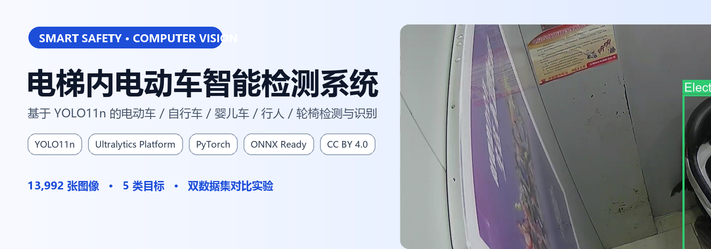
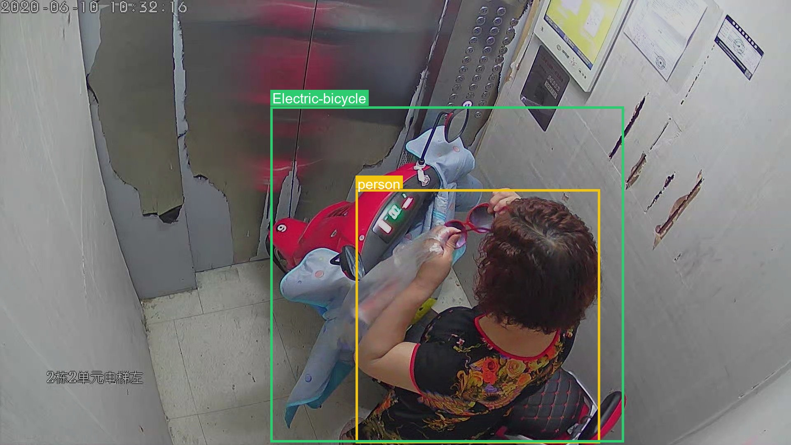
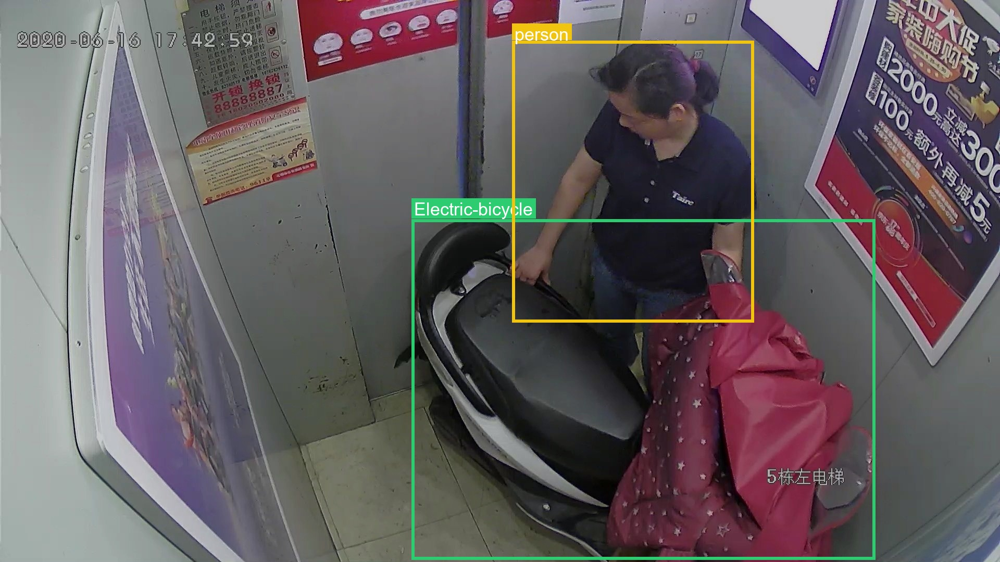
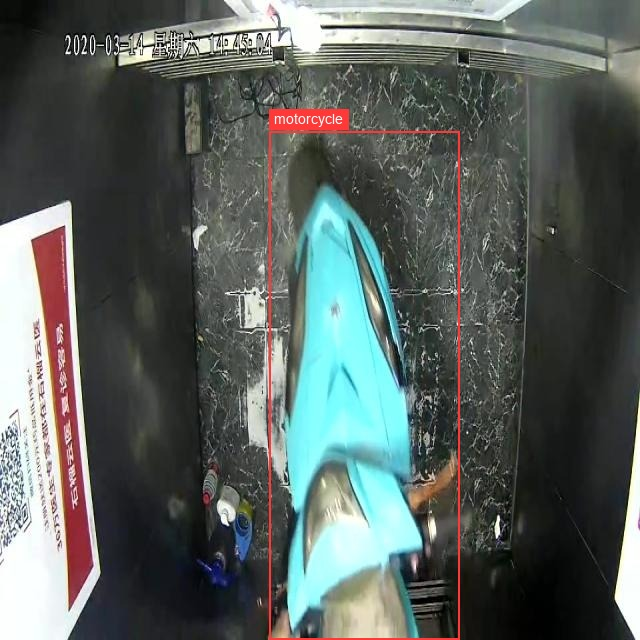

<div align="center">



# 电梯内电动车智能检测系统

**基于 YOLO11n 的电梯内电动车 / 自行车 / 婴儿车 / 行人 / 轮椅检测与识别**

[](https://github.com/)
[](https://www.python.org/)
[](LICENSE)
[](https://github.com/)
[](https://creativecommons.org/licenses/by/4.0/)
[](https://docs.ultralytics.com/)

[English](README_en.md) · [在线演示](https://shenyicong.github.io/elevator-ebike-detection/) · [数据集](#-数据集) · [快速开始](#-快速开始)

</div>

---

## 📖 项目简介

电动车进入电梯后起火的事故频发，是智慧社区与消防安全监管的重点难题。本项目基于 **YOLO11n** 轻量级目标检测模型，构建了一套面向电梯轿厢场景的电动车智能检测系统，可自动识别：

- 🛵 **Electric-bicycle**（电动车）
- 🚲 **bicycle**（自行车）
- 👶 **Baby-carriage**（婴儿车）
- 🧍 **person**（行人）
- ♿ **wheelchair**（轮椅）

系统融合两个公开数据集（合计 **13,992 张**图像），通过双数据集对比实验验证模型效果，并提供完整的数据处理、训练、推理与可视化流程，可部署于边缘计算设备实现实时预警。

<table align="center">
<tr>
<td align="center"><b>13,992</b><br><sub>训练图像</sub></td>
<td align="center"><b>5</b><br><sub>检测类别</sub></td>
<td align="center"><b>22,336</b><br><sub>标注框总数</sub></td>
<td align="center"><b>3</b><br><sub>训练方案</sub></td>
</tr>
</table>

## 🔄 技术流程

| 📥 数据获取 | 🧹 数据预处理 | 🧠 模型训练 | 📈 性能评估 | 🚀 推理部署 |
|:---:|:---:|:---:|:---:|:---:|
| 平台导出 NDJSON | 类别统一 / 格式转换 | YOLO11n 三组实验 | mAP / P / R 对比 | 图像 / 视频 / ONNX |

## 📊 实验结果

实验在 Ultralytics Platform 云端 GPU 上完成（100 epochs，imgsz=640）。指标请在训练完成后填入（`train.py` 会自动生成 `training_summary.csv`）。

| 实验 | 数据集 | 类别数 | 图像数 | mAP50 | mAP50-95 | P | R |
|:---|:---|:---:|:---:|:---:|:---:|:---:|:---:|
| Exp 1 | electric-bicycle-entering-elevator | 5 | 8,193 | — | — | — | — |
| Exp 2 | lift-ebike | 1 | 5,799 | — | — | — | — |
| Exp 3 | 合并数据集 | 5 | 13,992 | — | — | — | — |

> 💡 **填入指标的三种方式**：① 从 Ultralytics Platform 模型详情页 Results 复制；② 本地训练后读取 `runs/detect/*/results.csv`；③ 直接修改上表。

## 🗂️ 数据集

| 数据集 | 图像数 | 标注框 | 类别 | 划分 | 许可证 |
|:---|:---:|:---:|:---|:---|:---|
| [electric-bicycle-entering-elevator](https://platform.ultralytics.com/kingfisher-panther/datasets/electric-bicycle-entering-elevator) | 8,193 | 16,455 | 5 类 | train 6,551 / val 1,642 | CC BY 4.0 |
| [lift-ebike](https://platform.ultralytics.com/w-xiao/datasets/lift-ebike) | 5,799 | 5,881 | 1 类 (motorcycle) | train 4,287 / val 961 / test 551 | 见原页面 |

**类别统一策略**：合并数据集时，将 `lift-ebike` 的 `motorcycle` 映射为统一类别 `1: Electric-bicycle`。如需保留为独立类别：

```bash
python scripts/merge_ndjson.py --keep-motorcycle
```

## 🔍 检测效果

<div align="center">
<table>
<tr>
<td></td>
<td></td>
<td></td>
</tr>
<tr>
<td align="center"><sub>电动车 / 行人</sub></td>
<td align="center"><sub>多目标场景</sub></td>
<td align="center"><sub>电梯内电动车</sub></td>
</tr>
</table>
</div>

> 更多原图与标注图对照见 [在线演示](https://shenyicong.github.io/elevator-ebike-detection/)。

## 🚀 快速开始

### 环境安装

```bash
git clone https://github.com/shenyicong/elevator-ebike-detection.git
cd elevator-ebike-detection
pip install -r requirements.txt
```

### 方式一：在 Ultralytics Platform 云端训练（推荐）

数据已上传为私有数据集，配置 API Key 后直接引用 URI：

```bash
yolo settings api_key=<你的API_Key>
yolo detect train model=yolo11n.pt \
  data=ul://shenyicong/datasets/electric-bicycle-entering-elevator \
  epochs=100 imgsz=640 device=0
```

### 方式二：本地训练（AMD ROCm / CUDA）

```bash
# AMD 显卡先配置 ROCm 环境
bash scripts/setup_radeon.sh

# 下载数据集到本地（把两个 .ndjson 放到 data/ 后）
python scripts/download_ndjson.py \
  --ndjson data/electric-bicycle-entering-elevator.ndjson \
  --ndjson data/lift-ebike.ndjson \
  --out ./datasets --layout yolo

# 三组对比实验
python scripts/train.py --experiments 1,2,3 --epochs 100 --batch 16 --device 0
```

### 推理与导出

```bash
python scripts/predict.py --weights runs/detect/yolo11n_merged/weights/best.pt \
  --source data/test_images
python scripts/predict.py --weights best.pt --export   # 导出 ONNX
```

## 📁 项目结构

```
elevator-ebike-detection/
├── assets/                  # 展示图片（头图、社交预览、检测效果）
├── docs/                    # GitHub Pages 在线展示页
│   └── index.html
├── scripts/
│   ├── train.py             # 三组对比训练 + 指标 CSV
│   ├── predict.py           # 推理 / 导出 ONNX
│   ├── download_ndjson.py   # NDJSON → 本地图片 + YOLO 标签
│   ├── merge_ndjson.py      # 合并两个数据集 + 类别统一
│   ├── generate_xanylabeling_json.py  # 生成标注平台 JSON
│   ├── render_annotated.py  # 渲染标注后照片
│   └── setup_radeon.sh      # AMD ROCm 环境配置
├── data/data.yaml           # 统一 5 类数据集配置
├── requirements.txt
└── LICENSE
```

## 📝 引用

如果本项目对你的研究有帮助，请引用：

```bibtex
@misc{elevator_ebike_detection_2026,
  title={基于YOLO11n的电梯内电动车检测系统设计与实现},
  author={elevator-ebike-detection contributors},
  year={2026},
  howpublished={GitHub},
  url={https://github.com/shenyicong/elevator-ebike-detection}
}
```

## ⚖️ 许可证

- **源代码**：[MIT License](LICENSE)
- **数据集**：electric-bicycle-entering-elevator 遵循 [CC BY 4.0](https://creativecommons.org/licenses/by/4.0/)，lift-ebike 请见原始页面

---

<div align="center">
Made with ❤️ for smarter & safer elevators · Powered by <a href="https://docs.ultralytics.com/">Ultralytics YOLO11</a>
</div>
