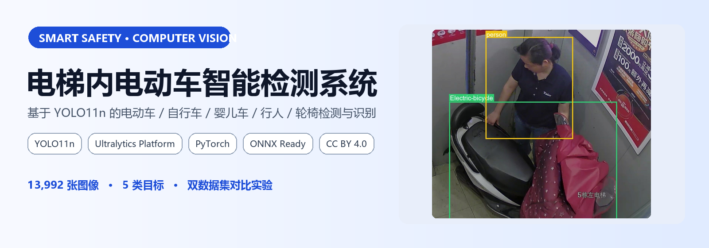
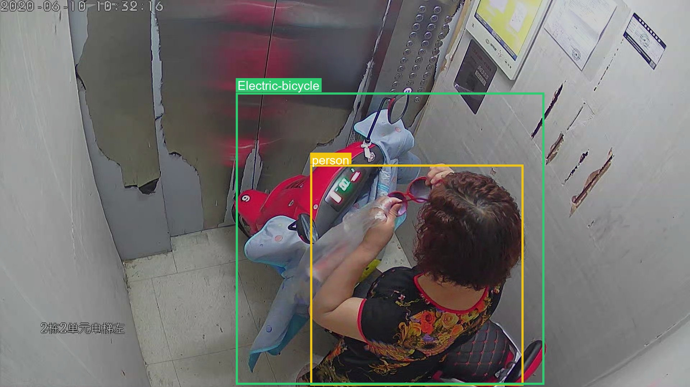
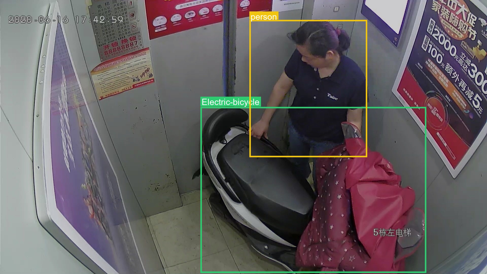
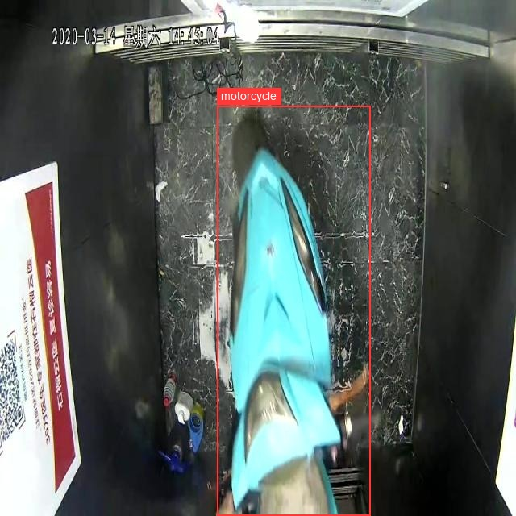

<div align="center">



# Elevator E-Bicycle Detection System

**YOLO11n-based detection of e-bicycles, bicycles, baby carriages, people and wheelchairs inside elevators**

[](https://github.com/)
[](https://www.python.org/)
[](LICENSE)
[](https://github.com/)
[](https://creativecommons.org/licenses/by/4.0/)
[](https://docs.ultralytics.com/)

[中文](README.md) · [Live Demo](https://shenyicong.github.io/elevator-ebike-detection/) · [Datasets](#-datasets) · [Quick Start](#-quick-start)

</div>

---

## 📖 Overview

E-bicycle fires inside elevators are a serious safety hazard in smart communities. This project builds an intelligent detection system for elevator cabins based on the lightweight **YOLO11n** model, automatically recognizing:

- 🛵 **Electric-bicycle**
- 🚲 **bicycle**
- 👶 **Baby-carriage**
- 🧍 **person**
- ♿ **wheelchair**

Combining two public datasets (**13,992 images** in total), the project runs comparative experiments and provides a complete pipeline for data processing, training, inference and visualization — deployable on edge devices for real-time alerts.

<table align="center">
<tr>
<td align="center"><b>13,992</b><br><sub>Images</sub></td>
<td align="center"><b>5</b><br><sub>Classes</sub></td>
<td align="center"><b>22,336</b><br><sub>Annotations</sub></td>
<td align="center"><b>3</b><br><sub>Experiments</sub></td>
</tr>
</table>

## 🔄 Pipeline

| 📥 Acquire | 🧹 Preprocess | 🧠 Train | 📈 Evaluate | 🚀 Deploy |
|:---:|:---:|:---:|:---:|:---:|
| Export NDJSON | Unify classes | YOLO11n × 3 | mAP / P / R | Image / Video / ONNX |

## 📊 Results

Trained on Ultralytics Platform cloud GPU (RTX PRO 6000, imgsz=640). The merged model `elevator-ebike-merged` has finished training and validation:

| Exp | Dataset | Classes | Images | mAP50 | mAP50-95 | P | R |
|:---|:---|:---:|:---:|:---:|:---:|:---:|:---:|
| Exp 1 | electric-bicycle-entering-elevator | 5 | 8,193 | — | — | — | — |
| Exp 2 | lift-ebike | 1 | 5,799 | — | — | — | — |
| **Exp 3** ⭐ | **Merged** | **5** | **13,992** | **89.5%** | **73.5%** | **93.4%** | **82.3%** |

> 🏆 **Best model**: Exp 3 trained on the merged dataset reaches **89.5% mAP50** and **93.4% precision**. Exported to ONNX and served in the [live demo](https://shenyicong.github.io/elevator-ebike-detection/) (Model 3).
>
> Training details: Ultralytics 8.4.218 · RTX PRO 6000 · 21 min runtime · $0.90 compute cost · ~14K images.
>
> 💡 Metrics for the single-dataset models (Exp 1/2) were not saved; copy them from the Results tab on Ultralytics Platform.

## 🗂️ Datasets

| Dataset | Images | Boxes | Classes | Split | License |
|:---|:---:|:---:|:---|:---|:---|
| [electric-bicycle-entering-elevator](https://platform.ultralytics.com/kingfisher-panther/datasets/electric-bicycle-entering-elevator) | 8,193 | 16,455 | 5 | train 6,551 / val 1,642 | CC BY 4.0 |
| [lift-ebike](https://platform.ultralytics.com/w-xiao/datasets/lift-ebike) | 5,799 | 5,881 | 1 (motorcycle) | train 4,287 / val 961 / test 551 | see page |

**Class mapping**: when merging, `motorcycle` from `lift-ebike` is mapped to `1: Electric-bicycle`. To keep it as a separate class:

```bash
python scripts/merge_ndjson.py --keep-motorcycle
```

## 🔍 Detections

<div align="center">
<table>
<tr>
<td></td>
<td></td>
<td></td>
</tr>
</table>
</div>

## 🚀 Quick Start

```bash
git clone https://github.com/shenyicong/elevator-ebike-detection.git
cd elevator-ebike-detection
pip install -r requirements.txt

# Train on Ultralytics Platform (private dataset URI)
yolo settings api_key=<YOUR_API_KEY>
yolo detect train model=yolo11n.pt \
  data=ul://shenyicong/datasets/electric-bicycle-entering-elevator \
  epochs=100 imgsz=640 device=0

# Inference / export
python scripts/predict.py --weights best.pt --source data/test_images
python scripts/predict.py --weights best.pt --export
```

## 📁 Structure

```
elevator-ebike-detection/
├── assets/                  # banner, social preview, detections
├── docs/index.html          # GitHub Pages site
├── scripts/                 # train / predict / download / merge / render
├── data/data.yaml           # unified 5-class config
├── requirements.txt
└── LICENSE
```

## 📝 Citation

```bibtex
@misc{elevator_ebike_detection_2026,
  title={Elevator E-Bicycle Detection System Based on YOLO11n},
  author={elevator-ebike-detection contributors},
  year={2026},
  howpublished={GitHub},
  url={https://github.com/shenyicong/elevator-ebike-detection}
}
```

## ⚖️ License

- **Code**: [MIT License](LICENSE)
- **Datasets**: electric-bicycle-entering-elevator is [CC BY 4.0](https://creativecommons.org/licenses/by/4.0/); see original page for lift-ebike.

---

<div align="center">
Made with ❤️ for smarter & safer elevators · Powered by <a href="https://docs.ultralytics.com/">Ultralytics YOLO11</a>
</div>
